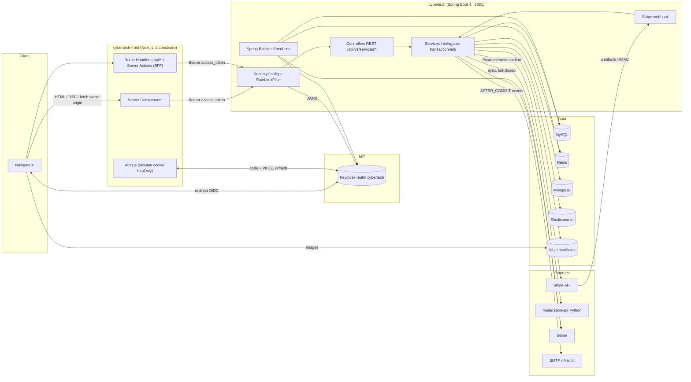
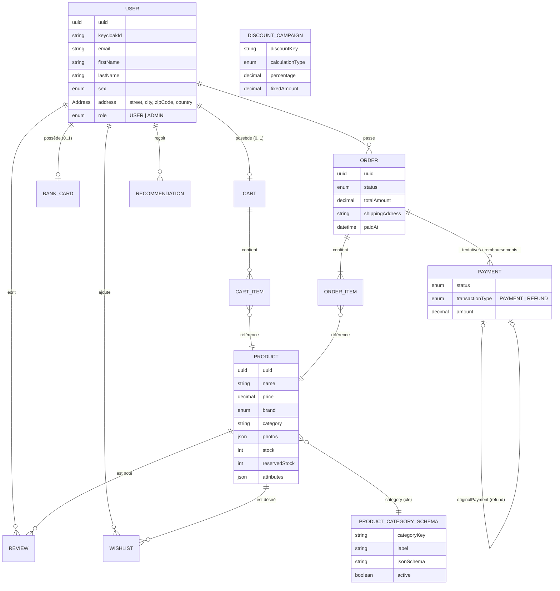
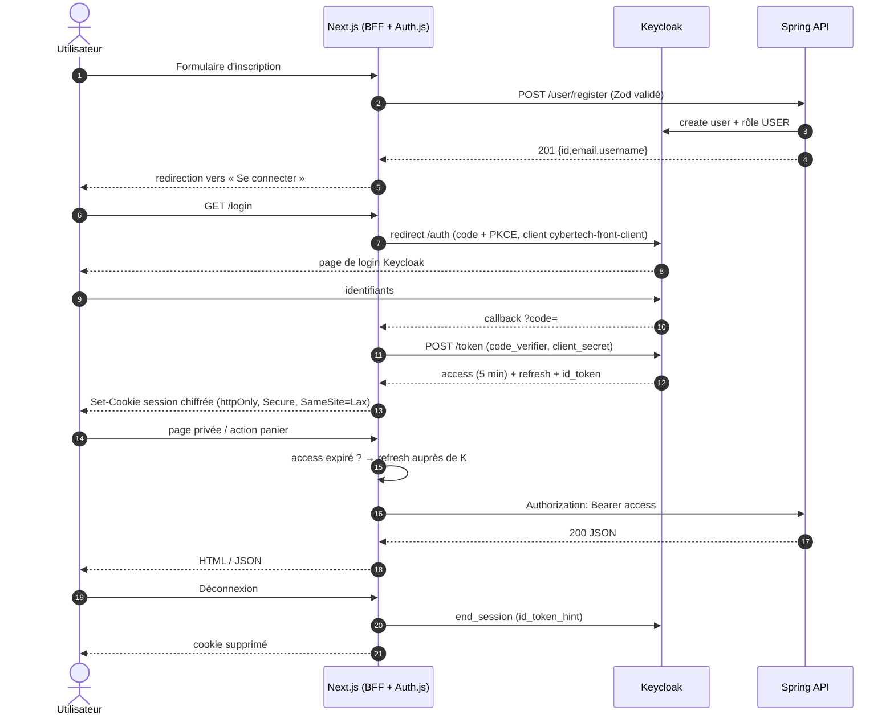

# Analyse fonctionnelle et technique du backend cybertech

> Repo backend lu en lecture seule : `cybertech-dev-develop_cybertech`, branche `develop_back`, commit `7623204` (2026-10-13).
> Abréviations : `{pkg}` = `src/main/java/com/novatech/cybertech`, `{res}` = `src/main/resources`. Détail des endpoints : [`api-map.md`](./api-map.md).

## 0. Fiche d'identité technique

| Élément | Valeur | Source |
|---|---|---|
| Langage / runtime | Java **26** (`--enable-preview`), threads virtuels activés | `pom.xml:31`, `application.properties` (`spring.threads.virtual.enabled`) |
| Framework | Spring Boot **4.0.4**, Spring Cloud **2025.1.1** | `pom.xml:7-10,32` |
| Build | Maven (`./mvnw`) | `pom.xml` |
| Base relationnelle | **MySQL** (Hibernate, `ddl-auto=update`) — et non PostgreSQL comme indiqué dans le prompt initial | `application.properties` |
| Autres stores | Redis (cache, verrous Redisson, réservations de stock, ShedLock), MongoDB (événements utilisateur), Elasticsearch (recherche produit) | `RedisConfig.java`, `application.properties` |
| Auth | **Keycloak** (OAuth2 resource server, JWT RS256) — pas de JWT maison | `SecurityConfig.java:168`, `KeycloakRoleConverter.java` |
| Paiement | Stripe Java SDK (PaymentIntent confirmé côté serveur + webhooks HMAC) | `StripePaymentAttemptProcessor.java`, `StripeWebhookController.java` |
| Stockage images | AWS S3 (LocalStack en dev), bucket `cybertech-products` | `S3ServiceImp.java`, `application.properties` |
| Recommandation | Gorse (sync batch + lecture via circuit breaker) | `GorseClient.java`, `RecommendationServiceImp.java` |
| Modération | Microservice Python (toxic-bert) `moderation-api:5000/analyze`, appel **synchrone** | `CommentModerationClient.java`, `docker-compose.yml:212-218` |
| Batch | Spring Batch + ShedLock : annulation des commandes impayées, expédition, nettoyage du stock, redelivery des notifications, outbox Keycloak, sync Gorse | `application.properties` (`cybertech.*.job.*`) |
| Résilience | Resilience4j (Stripe, modération, Gorse, notifications) | `application.properties` |
| Secrets | Spring Cloud Vault (désactivé en dev : `spring.cloud.vault.enabled=false`) | `application.properties` |
| OpenAPI | springdoc 3 (`/v3/api-docs`, `/swagger-ui.html`) ; spec générée commitée `docs/openapi/openapi.yaml` (64 opérations), **alignée avec le code** depuis le 2026-10-02 | `application.properties`, `progress.md` du backend |
| API Gateway / Spring Cloud Config | **Absents** du code actuel | — |

### Infra locale (`{res}/docker/docker-compose.yml`)

| Service | Image | Port hôte |
|---|---|---|
| mysql | `mysql:9.3.0` | 3306 |
| mongodb | `mongo:8.2.5` | 27017 |
| redis | `redis:latest` | 6379 |
| elasticsearch | `elasticsearch:9.2.5` | 9200 |
| gorse | `zhenghaoz/gorse-in-one` | 8088, 8089 |
| keycloak | `quay.io/keycloak/keycloak:24.0.3` (realm importé au boot) | 8080 |
| localstack (S3) | `localstack/localstack:4.13.1` | 4566 |
| vault | `hashicorp/vault:1.21.4` | 8200 |
| mailpit | `axllent/mailpit` | 1025 (SMTP), 8025 (UI) |
| moderation-api | build local (Python) | 5000 |
| stripe-cli | `stripe/stripe-cli:v1.37.1` | — (forward webhooks → `host.docker.internal:8081`) |

Le backend Spring lui-même **n'est pas dans le docker-compose** : il tourne sur l'hôte (`./mvnw spring-boot:run`, port 8081).

### Kubernetes / Helm (`{res}/k8s/helm`)

Helmfile avec un chart par composant, dont **`front-app-chart`** déjà prêt pour Next.js standalone : port 3000, ingress `cybertech.local`, variables `NEXT_PUBLIC_API_BASE=https://api.cybertech.local`, `AUTH_URL`, secrets `AUTH_SECRET`, `AUTH_KEYCLOAK_ID=cybertech-front-client`, `AUTH_KEYCLOAK_SECRET`, `AUTH_KEYCLOAK_ISSUER` (convention **Auth.js / NextAuth v5**). Backend exposé via ingress `api.cybertech.local` (path `/api/`), Keycloak via `keycloak.cybertech.local`. En prod, CORS autorise `https://cybertech.local` (`application-prod.properties`).

---

## 1. Architecture

Points clés :
- Le backend est **stateless** (pas de session HTTP) et ne connaît l'utilisateur que via le JWT Keycloak (`sub` = `keycloakId`).
- Les effets secondaires (emails, expédition) sont asynchrones : événements `@TransactionalEventListener(AFTER_COMMIT)` + jobs batch toutes les 10–15 min.
- Les images produit sont servies **directement par S3** (URL absolues), pas par le backend.

## 2. Modèle de domaine

Source : `{pkg}/entities/*.java` (toutes héritent de `BaseEntity` : id interne + `uuid` public + audit `createdAt`).

Stores hors MySQL : `ProductDocument` (index ES `products`, `entities/document/ProductDocument.java`), `UserEvent` (MongoDB `userEventsDB`), réservations de stock et cache panier (Redis).

## 3. Flux d'authentification complet

### 3.1 Ce que fait réellement le backend

1. **Inscription** — `POST /api/v1/services/user/register` (public, 5 req/min/IP). `UserPersistenceService` orchestre une saga : création de l'utilisateur Keycloak (`enabled=true`, `emailVerified=true`, rôle realm `USER`) puis de `UserEntity` en MySQL ; un outbox Keycloak rattrape les crashs (`KeycloakUserManagementServiceImp.java:84-85`, `UserManagementServiceImp.java:68`, job `cybertech.keycloak.outbox.*`). Réponse `201 { id, email, username }`. **L'inscription ne connecte pas l'utilisateur** : aucun token n'est renvoyé.
2. **Connexion** — **pas d'endpoint backend**. Elle se fait auprès de Keycloak (OIDC). Le realm exporté n'a **aucun client destiné au front** : seuls `cybertech-postman-client-id` et `cybertech-user-management-client` (confidentiels, *direct access grants* activés) existent. Le chart Helm du front attend `cybertech-front-client`.
3. **Token** — access token JWT signé par Keycloak, durée **300 s**. Rôles dans `realm_access.roles` (`USER`, `ADMIN`, plus `ROLE_USER`, `offline_access`, …), convertis en `ROLE_USER` / `ROLE_ADMIN` (`KeycloakRoleConverter.java:20-31`). `sub` = identifiant Keycloak, utilisé par tous les services comme clé utilisateur.
4. **Expiration** — le backend rejette un token expiré en **401** `{"message":"Authentication required",...}`.
5. **Refresh** — fourni par Keycloak (refresh token standard), valable tant que la session SSO est active : inactivité max **30 min**, durée max **10 h** ; `revokeRefreshToken=false` (le refresh token n'est pas à usage unique).
6. **Logout** — aucun endpoint backend (stateless) ; le front doit (a) détruire sa session et (b) appeler le logout OIDC de Keycloak (`end_session_endpoint`) pour fermer la session SSO.
7. **CSRF** — désactivé côté backend (Bearer token). Côté front, la session en cookie `SameSite=Lax` + Server Actions (protégées par Next.js contre le cross-origin) couvrent le risque.

### 3.2 Flux cible proposé pour le front (BFF)

## 4. Cycle de vie du panier

Sources : `CartServiceImp.java`, `CartWriteTransactionalDelegateImp.java`, `CartCacheHelperImp.java`, `OrderCreationTransactionalDelegateImp.java`, `OrderManagementServiceImp.java:499-528`.

| Étape | Comportement réel |
|---|---|
| **Création** | Implicite au premier `POST /cart/add` (`CartWriteTransactionalDelegateImp.java:74-81`). Un panier par utilisateur (`UserEntity.cartEntity`, 1-1). Pas d'endpoint de création. |
| **Persistance** | **MySQL est la source de vérité** ; Redis n'est qu'un cache (`cart::<keycloakId>`, TTL 7200 s ± 3600 s de jitter, glissant à chaque lecture). → le panier est **naturellement multi-appareil** pour un utilisateur connecté. |
| **Concurrence** | Verrou distribué Redisson `cart:lock:<keycloakId>` autour de chaque écriture ; commit avant libération du verrou ; échec d'acquisition → 500 (voir api-map §E.2). |
| **Ajout** | Additif. Contrôle de stock *advisory* : `quantité demandée + reservedStock ≤ stock`, sinon **409 `NOT_ENOUGH_STOCK`** avec le stock disponible dans le message (`CartStockValidator.java:45`). Le stock **n'est pas réservé** à l'ajout au panier. |
| **Mise à jour** | `PATCH /cart/update/{cartUuid}` remplace toutes les lignes (quantités absolues), validation de toutes les lignes avant mutation. `DELETE /cart/decreaseQuantity` décrémente. `PATCH /cart/remove/{productUuid}` supprime la ligne. |
| **Vidage** | `DELETE /cart/clear` → 204. |
| **Panier anonyme / fusion** | **Inexistants.** Tous les endpoints exigent un JWT `USER`/`ADMIN`. Aucune fusion anonyme → connecté côté backend. |
| **Expiration** | Seul le cache Redis expire ; le panier MySQL n'expire pas. Aucune purge des paniers abandonnés ⚠️ À CONFIRMER (aucun job identifié). |
| **Conversion en commande** | `POST /order/place` lit le panier serveur, crée la commande `AWAITING_PAYMENT`, **réserve le stock** (Redis avec TTL, libéré par `RedisExpirationListener` ou le job de nettoyage), vide le panier dans la même transaction puis invalide le cache (`OrderCreationTransactionalDelegateImp.java:128-141`, `OrderManagementServiceImp.java:525-528`). Le paiement Stripe est tenté immédiatement. |

## 5. Parcours utilisateur

### Possibles aujourd'hui
- Parcourir le catalogue : recherche plein texte fuzzy, filtres catégorie / marques / prix / attributs, best-sellers, fiche produit.
- S'inscrire (backend) puis se connecter (Keycloak).
- Gérer un panier serveur persistant (ajout, quantités, suppression, vidage).
- Passer commande (adresse, transporteur DHL/FedEx, standard/express, code promo), suivre son statut (polling), la modifier pendant la fenêtre de 30 min après paiement, l'annuler avant expédition, relancer un paiement échoué, consulter l'historique paginé.
- Wishlist (ajout, retrait, liste paginée).
- Laisser, modifier, supprimer un avis sur un produit acheté (modéré par IA).
- Enregistrer une carte (masquée en lecture).
- Recevoir des recommandations personnalisées ; émettre des événements comportementaux.
- Modifier son profil (nom, téléphone, adresse).
- Administration complète (produits avec images, catégories, remises, commandes, utilisateurs).

### Pas encore possibles (côté backend)
- Panier invité et fusion à la connexion.
- Afficher stock / disponibilité, note moyenne et avis publics sur une fiche produit.
- Trier le catalogue, obtenir des facettes, autocomplétion.
- Lister les catégories publiquement.
- Obtenir son propre profil (`GET /me`).
- Voir un récapitulatif chiffré (remise, frais de port) **avant** de commander.
- Payer avec une vraie carte côté client (Stripe Elements / 3DS) : le paiement est simulé côté serveur.
- Mot de passe oublié / changement de mot de passe dans l'app (Keycloak seulement).
- Supprimer son compte, suivre un colis, télécharger une facture.
- « Derniers produits consultés » (les événements sont collectés mais aucune API de lecture).

## 6. Contraintes pour le front

| Contrainte | Détail | Source |
|---|---|---|
| **CORS** | Origine autorisée `http://localhost:3000` (dev) / `https://cybertech.local` (prod), credentials autorisés. Avec le pattern BFF, le navigateur n'appelle jamais le backend → CORS non sollicité (sauf images S3, en ``/`next/image`, non soumises à CORS). | `SecurityConfig.java:225-244`, `application-prod.properties` |
| **Rate limiting** | Bucket4j **en mémoire** : register 5/min/IP, `order/place*` 30/min/utilisateur, `cart/**` 60/min/utilisateur. **Attention BFF** : sans JWT (register), toutes les requêtes viennent de l'IP du serveur Next.js → **5 inscriptions/min pour tout le site**. Les requêtes authentifiées sont clefées par `sub`, donc non impactées. | `RateLimitFilter.java:284-426` |
| **Modération** | Création d'avis bloquante (appel HTTP synchrone, retry 2× 300 ms, circuit breaker 30 s). Indisponible → **403 fail-closed** avec un message « hateful » trompeur. Prévoir un état d'attente et un message neutre. | `CommentModerationClient.java:37-62`, `application.properties` |
| **Paiement** | `POST /order/place` confirme le PaymentIntent côté serveur avec un `payment_method` de configuration (`pm_card_visa` en dev). Le résultat définitif arrive par webhook → statut `PAID` asynchrone : la page de confirmation doit **poller** `GET /order/status/{uuid}`. | `StripePaymentAttemptProcessor.java:179-195` |
| **Versioning** | Envoyer `X-API-VERSION: 1.0`. | `application.properties` |
| **Token court** | Access token 5 min → refresh systématique côté BFF avant chaque appel. | realm export |
| **Images** | Domaines S3 à autoriser dans `next.config` (`images.remotePatterns`) : `localhost:4566` en dev ; domaine prod ⚠️ À CONFIRMER. | `S3ServiceImp.java:57` |
| **CSP backend** | Le backend envoie une CSP *report-only* sur ses réponses JSON ; sans effet sur le front. | `SecurityConfig.java:112-117` |
| **Emails** | Les liens des emails pointent vers `application.frontend.url` (`http://localhost:4200` en dev) : à aligner sur le port du front. | `application.properties` |

## 7. Risques et points d'attention pour l'intégration

1. **Client Keycloak front manquant** — à créer (confidentiel, Authorization Code + PKCE, redirect `http://localhost:3000/api/auth/callback/keycloak`, post-logout `http://localhost:3000/`) et à ajouter à `cybertech-realm.json` côté backend. Bloquant pour l'auth.
2. **Pas de `GET /me`** — l'UUID local de l'utilisateur n'est pas obtenable proprement ; les claims de l'ID token suffisent pour l'affichage (prénom, email).
3. **Panier invité** — exigé par le parcours « utilisateur non connecté qui ajoute au panier » mais absent du backend : à implémenter dans le BFF (cookie signé) avec rejeu `POST /cart/add` à la connexion, en gérant les 409 de stock pendant la fusion.
4. **Erreurs non typées** — mapping statut HTTP → message utilisateur à centraliser ; ne pas confondre les 403 métier (panier vide, modération) avec un refus d'accès.
5. **Rate limit d'inscription global** derrière le BFF (cf. §6) — le filtre utilise `request.getRemoteAddr()`. En **prod**, `server.forward-headers-strategy=framework` (`application-prod.properties:24`) lui fait lire `X-Forwarded-For` : le BFF doit donc **transmettre l'IP du client**. En **dev**, la stratégie n'est pas configurée → quota global de 5/min.
6. **Stock invisible** — l'UI ne peut pas désactiver « Ajouter au panier » en rupture ; l'erreur 409 doit être gérée avec élégance (message incluant le stock disponible).
7. **Paiement simulé** — le choix `paymentType` est cosmétique ; ne pas présenter de champ carte au lot 1, ou le marquer clairement comme démo.
8. **Montants** — `BigDecimal` → `number` JS : formater avec `Intl.NumberFormat('fr-FR', { style: 'currency', currency: 'EUR' })`, ne jamais recalculer de totaux côté front (les totaux serveur font foi).
9. **Dates sans fuseau** (`LocalDateTime`) — interpréter comme heure serveur (UTC dans le JDBC `serverTimezone=UTC`) ⚠️ À CONFIRMER.
10. **Recherche** — `priceMin ≥ 100`, pas de tri, recherche vide à valider ; l'index Elasticsearch est alimenté de façon synchrone par `ProductManagementServiceImp` (via `ProductSearchRepository`) lors des opérations admin — aucun Kafka dans le code actuel ; un produit créé hors de ce service n'apparaît pas dans la recherche.
11. **Backend hors docker-compose** — pour le `docker-compose` du front, il faudra soit un Dockerfile backend (`{res}/docker/dockerfile` existe), soit lancer le backend sur l'hôte et pointer `http://host.docker.internal:8081`.
12. **Écarts avec le prompt initial** — PostgreSQL → MySQL ; JWT maison → Keycloak ; API Gateway non présente. Les prompts Spec Kit suivent le code.
