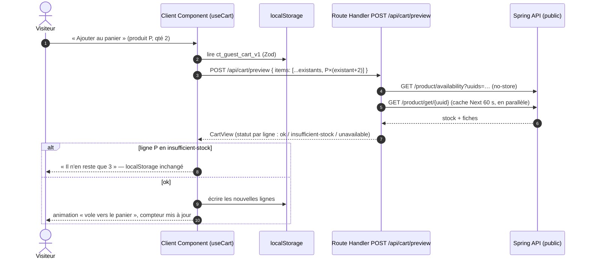
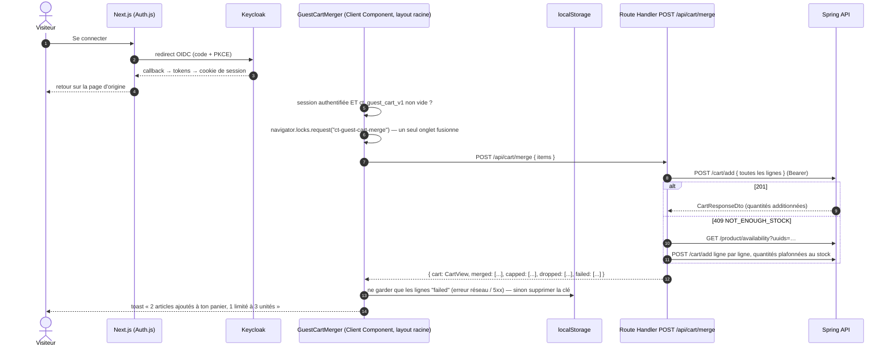

# Panier invité (visiteur non connecté) — conception

> **Décision (2026-10-13) : option B, `localStorage` + fusion à la connexion.** C'est l'option la plus simple qui couvre le besoin. Les options écartées sont décrites au §8.
>
> Le backend n'a pas de panier anonyme : tous les endpoints `/api/v1/services/cart/**` exigent un JWT `USER`/`ADMIN`. Le panier du visiteur vit donc dans le navigateur, puis il est **fusionné une seule fois** dans le panier serveur à la connexion. Ensuite, le backend redevient l'unique source de vérité.

## 1. Les trois états du panier

| État | Où vit le panier | Qui fait foi | Prix / total |
|---|---|---|---|
| **Visiteur** | `localStorage` du navigateur, clé `ct_guest_cart_v1` (lignes `productUuid` + `quantity` uniquement) | Le navigateur | Prix et stock relus en direct via le BFF à chaque affichage ; total **estimé** |
| **Connexion** | Transition unique : les lignes sont rejouées dans le panier serveur via le BFF → `POST /cart/add` | — | — |
| **Connecté** | MySQL (cache Redis) côté backend | Le backend | Total calculé par le backend (`CartResponseDto.totalPrice`) |

Les composants d'affichage ne savent pas dans quel état ils sont : un hook unique `useCart()` renvoie la même forme `CartView` dans les deux cas. Seule sa source change : `localStorage` + `POST /api/cart/preview` pour un visiteur, `GET /api/cart` pour un utilisateur connecté.

## 2. Le stockage local

| Propriété | Valeur | Pourquoi |
|---|---|---|
| Clé | `ct_guest_cart_v1` | Le suffixe de version permet de changer le format plus tard sans lire d'anciennes données mal formées. |
| Contenu | `{"items":[{"productUuid":"<uuid>","quantity":2}],"updatedAt":"2026-10-13T10:00:00Z"}` | Seulement des identifiants et des quantités : aucun prix, aucune donnée personnelle, aucun token. |
| Validation | Schéma Zod à chaque lecture ; contenu invalide → panier remis à zéro | Le contenu est modifiable par l'utilisateur : on ne lui fait pas confiance, et le backend revalide tout de toute façon. |
| Limites | 50 lignes max, quantité 1–99 par ligne | Garde-fou simple. |
| Multi-onglets | Écoute de l'événement `storage` → mise à jour du cache TanStack Query `['cart']` | Un ajout dans un onglet apparaît dans les autres. |

**Compatibilité avec la constitution** : la règle « jamais en `localStorage` » vise les **tokens**. Une liste d'UUID produits n'est pas sensible : la voler via une faille XSS n'apporte rien à l'attaquant.

**Seul inconvénient** : le serveur ne voit pas ce panier, donc le badge du panier d'un visiteur ne peut pas être rendu côté serveur. Pour éviter un saut de mise en page (CLS), le badge réserve sa place et n'affiche le nombre qu'après hydratation.

## 3. Visiteur : lecture et écriture



- **Lecture** : `useCart()` lit le `localStorage` puis appelle `POST /api/cart/preview` avec les lignes. Le BFF renvoie un `CartView` enrichi : nom, image, prix unitaire actuel, sous-total, stock disponible, statut de chaque ligne.
- **Produit supprimé** (404 côté backend) : la ligne revient avec le statut `unavailable`, le client la retire du `localStorage` et l'utilisateur en est informé.
- **Prix** : jamais stockés, toujours relus. Le total affiché au visiteur est marqué « estimé » : c'est le seul endroit où le BFF fait une addition, et elle n'engage à rien puisque le backend recalcule le vrai total après la fusion.
- **Stock** : vérifié avant chaque écriture grâce à la prévisualisation. Il n'est pas réservé ; la réservation n'a lieu qu'à la commande, comme pour un utilisateur connecté.

## 4. La fusion à la connexion



Règles :

1. **Déclenchement** : un composant client `GuestCartMerger`, monté une fois dans le layout racine, lance la fusion dès que la session devient « authentifiée » et que le panier local n'est pas vide. Aucun code dans les callbacks Auth.js.
2. **Un seul onglet** : `navigator.locks` (Web Locks API) garantit qu'un seul onglet fusionne. Les autres relisent le `localStorage` une fois le verrou libéré et voient qu'il est vide.
3. **Sémantique** : additive, car `POST /cart/add` additionne côté serveur. Exemple : 2 en invité + 1 déjà dans le compte = 3.
4. **Stock** : en cas de 409, le BFF repasse ligne par ligne en plafonnant chaque quantité au stock disponible. Les lignes plafonnées (`capped`) ou impossibles (`dropped` : rupture, produit supprimé) sont rapportées à l'utilisateur, puis retirées du `localStorage`.
5. **Pas de double ajout** : les lignes déjà fusionnées sont retirées du `localStorage`. Seules les lignes en échec technique (`failed` : réseau, 5xx) restent, pour être retentées au chargement de page suivant. Cas limite accepté : si la réponse se perd alors que le backend a déjà ajouté les lignes, une nouvelle tentative pourrait doubler une ligne. Un endpoint backend `POST /cart/merge` avec clé d'idempotence supprimerait ce cas ; il est optionnel, pas dans le lot 1.

## 5. Connecté : synchronisation front ↔ back

- **Source de vérité** : le backend. Le front ne garde qu'un **cache** TanStack Query (`['cart']`), avec `staleTime` à 30 s, rechargement au retour sur l'onglet et invalidation après chaque mutation.
- **Mutations** : mises à jour optimistes, remplacées par la réponse du backend (`CartResponseDto`) ou annulées en cas d'erreur. Le BFF mappe les endpoints : `POST /cart/add` pour ajouter, `PATCH /cart/update/{cartUuid}` pour fixer une quantité absolue, `PATCH /cart/remove/{productUuid}` pour retirer une ligne, `DELETE /cart/clear` pour vider.
- **Multi-appareil** : le panier est en MySQL, donc tous les appareils voient le même. Une modification faite ailleurs apparaît au plus tard au retour sur l'onglet. Il n'y a pas de temps réel, ce qui suffit pour un panier.
- **Concurrence** : le backend sérialise les écritures avec un verrou Redis. Un verrou occupé renvoie un 409 `CONCURRENT_MODIFICATION`, que le BFF rejoue une fois automatiquement.
- **Session expirée** : le panier est côté serveur, donc rien n'est perdu. Le BFF renouvelle le token ; si c'est impossible, il redirige vers la connexion puis revient à l'action.
- **Déconnexion** : le `localStorage` est vide depuis la fusion. Le panier du compte n'est **pas** recopié dans le navigateur, pour qu'un appareil partagé n'en garde pas de trace ; il sera retrouvé à la prochaine connexion.

## 6. Contrats internes (Zod, `lib/schemas/cart.ts`)

```ts
type GuestCartStorage = {
  items: Array<{ productUuid: string; quantity: number }>; // max 50, quantity 1..99
  updatedAt: string;                                        // ISO-8601
};

type CartLineStatus = "ok" | "insufficient-stock" | "unavailable";
type CartView = {
  source: "guest" | "account";
  cartUuid: string | null;           // null pour un invité ou un panier vide
  lines: Array<{
    productUuid: string;
    name: string;
    imageUrl: string | null;
    unitPrice: number;
    quantity: number;
    lineTotal: number;
    availableStock: number | null;   // null si inconnu
    status: CartLineStatus;
  }>;
  total: number;
  totalIsEstimate: boolean;           // true pour un invité
  itemCount: number;
};

type MergeReport = {
  cart: CartView;
  merged: string[];                                   // productUuid fusionnés tels quels
  capped: Array<{ productUuid: string; requested: number; added: number }>;
  dropped: Array<{ productUuid: string; reason: "out-of-stock" | "not-found" }>;
  failed: Array<{ productUuid: string; quantity: number }>; // à retenter
};
```

## 7. Routes BFF et endpoints utilisés

| Route BFF | Rôle | Endpoint(s) Spring | Auth |
|---|---|---|---|
| `POST /api/cart/preview` | Enrichit les lignes invitées (fiches + stock) | `GET /product/get/{uuid}`, `GET /product/availability?uuids=` | public |
| `POST /api/cart/merge` | Fusion à la connexion | `POST /cart/add` (puis `GET /product/availability` si 409) | USER |
| `GET /api/cart` | Panier du compte | `GET /cart/get` | USER |
| `POST /api/cart` | Ajout | `POST /cart/add` | USER |
| `PATCH /api/cart/items/[productUuid]` | Quantité absolue | `PATCH /cart/update/{cartUuid}` | USER |
| `DELETE /api/cart/items/[productUuid]` | Retrait d'une ligne | `PATCH /cart/remove/{productUuid}` | USER |
| `DELETE /api/cart` | Vidage | `DELETE /cart/clear` | USER |

## 8. Options écartées

| Option | Pourquoi pas |
|---|---|
| A. Pas de panier invité (connexion obligatoire avant d'ajouter) | Plus simple encore, mais ajoute une friction d'achat et contredit le cas limite « visiteur qui ajoute au panier » de la spec. |
| C. Cookie signé `httpOnly` géré par le BFF | Seul gain : badge rendu côté serveur. En échange, il faut une signature HMAC, un secret de plus, la lecture et l'écriture du cookie dans chaque route et un cookie de rapport de fusion, pour un panier qui n'est pas une donnée sensible. |
| Panier anonyme côté backend | Il faudrait une identité anonyme, un job de purge des paniers abandonnés, et le rate limiting par IP du backend pénaliserait tous les visiteurs derrière le BFF. |
