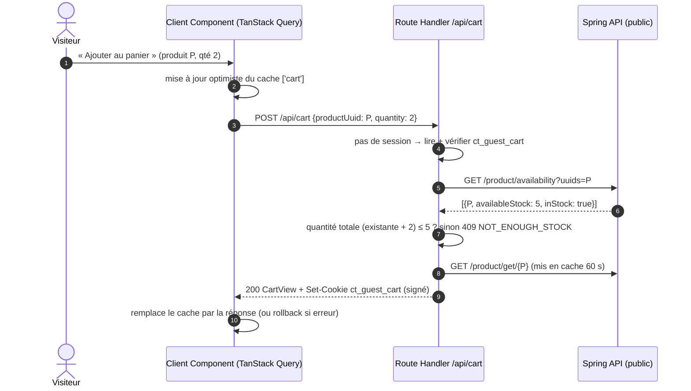
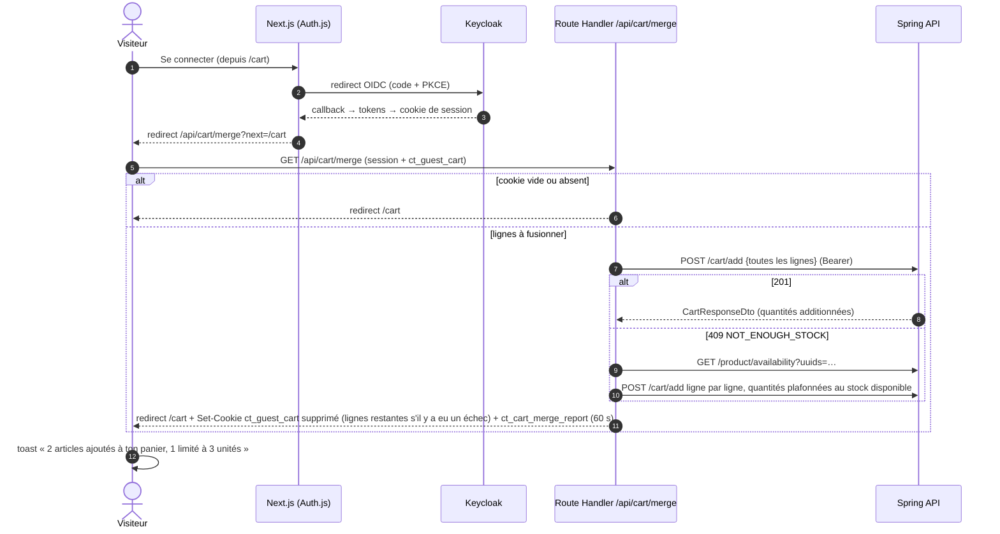

# Panier invité (visiteur non connecté) — conception

> Le backend n'a pas de panier anonyme : tous les endpoints `/api/v1/services/cart/**` exigent un JWT `USER`/`ADMIN`. Le panier du visiteur est donc porté par le **BFF Next.js**, dans un cookie, puis **fusionné une seule fois** dans le panier serveur au moment de la connexion. Ensuite, le backend redevient l'unique source de vérité.

## 1. Les trois états du panier

| État | Où vit le panier | Qui fait foi | Prix / total |
|---|---|---|---|
| **Visiteur** | Cookie `ct_guest_cart` du navigateur (lignes `productUuid` + `quantity` uniquement) | Le cookie | Prix relus en direct au backend à chaque affichage ; total **indicatif** calculé par le BFF |
| **Connexion** | Transition unique : le cookie est rejoué dans le panier serveur via `POST /cart/add` | — | — |
| **Connecté** | MySQL (cache Redis) côté backend | Le backend | Total calculé par le backend (`CartResponseDto.totalPrice`) |

Les composants React ne savent pas dans quel état ils sont : le BFF expose **la même forme de réponse** (`CartView`) dans les deux cas. Seule la couche `features/cart/server/` choisit la source (cookie ou backend).

## 2. Le cookie

| Propriété | Valeur | Pourquoi |
|---|---|---|
| Nom | `ct_guest_cart` | — |
| Contenu | `{"v":1,"items":[{"p":"<uuid>","q":2}],"u":1760000000}` signé HMAC-SHA256 (`GUEST_CART_SECRET`) | Seulement des identifiants et des quantités : aucun prix, aucune donnée personnelle. La signature empêche un contenu forgé (UUID invalides, quantités négatives) d'atteindre le backend. |
| `HttpOnly` | oui | Le JavaScript du navigateur ne le lit ni ne l'écrit : seul le BFF le manipule (cohérent avec la règle « aucun état sensible côté client »). Les Server Components peuvent le lire pour rendre le badge et la page panier côté serveur. |
| `Secure` | oui hors `localhost` | — |
| `SameSite` | `Lax` | Envoyé en navigation normale, pas sur les requêtes cross-site (protection CSRF des mutations). |
| `Path` | `/` | — |
| `Max-Age` | 30 jours, renouvelé à chaque écriture | Un visiteur qui revient retrouve son panier. |
| Limites | 50 lignes max, quantité 1–99 par ligne | Un cookie est limité à ~4 Ko : 50 lignes × ~45 octets ≈ 2,3 Ko. |

Pourquoi pas `localStorage` : il n'est pas lisible par le serveur (pas de rendu serveur du panier, flash d'UI vide au chargement), et la constitution interdit d'y mettre de l'état applicatif. Pourquoi pas un panier anonyme côté backend : il faudrait une identité anonyme, un job de purge des paniers abandonnés, et le rate limiting par IP du backend pénaliserait tous les visiteurs derrière le BFF.

## 3. Visiteur : lecture et écriture



- **Lecture** (`GET /api/cart`) : le BFF lit le cookie, récupère les produits (`GET /product/get/{uuid}` en parallèle, cache Next de 60 s) et la disponibilité (`GET /product/availability`, jamais en cache), puis construit `CartView` : nom, image, prix unitaire actuel, quantité, sous-total, et le statut de chaque ligne (`ok`, `insufficient-stock`, `unavailable`).
- **Produit supprimé** (404) : la ligne est retirée du cookie et un message signale qu'un article n'est plus disponible.
- **Prix** : jamais stockés dans le cookie, toujours relus. Le total affiché au visiteur est marqué « estimé » : c'est le seul cas où le BFF fait une addition, et elle n'engage à rien puisque le total réel est recalculé par le backend après la fusion.
- **Stock** : contrôlé à l'ajout grâce à `GET /product/availability`. Le stock n'est **pas réservé** (comme pour un utilisateur connecté, la réservation n'a lieu qu'à la commande).

## 4. La fusion à la connexion



Règles :

1. **Déclenchement** : `signIn("keycloak", { redirectTo: "/api/cart/merge?next=<page>" })`. La fusion s'exécute dans une requête serveur qui dispose déjà du token d'accès frais. Elle n'est pas faite dans les callbacks Auth.js, qui ne peuvent pas écrire de cookie de façon fiable.
2. **Sémantique** : additive, car `POST /cart/add` additionne côté serveur. Exemple : 2 en invité + 1 déjà dans le compte = 3.
3. **Stock** : si l'ajout groupé renvoie 409, on repasse ligne par ligne en plafonnant chaque quantité au stock disponible. Les lignes plafonnées ou impossibles alimentent le rapport de fusion.
4. **Exactement une fois** : le cookie n'est supprimé qu'après un succès. En cas d'échec partiel, il est réécrit avec **seulement les lignes non fusionnées**, ce qui évite de rajouter deux fois une ligne déjà passée (`/cart/add` est additif). Cas limite accepté : si le navigateur perd la réponse alors que le backend a déjà validé l'ajout, une nouvelle tentative pourrait doubler une ligne. Un endpoint backend `POST /cart/merge` avec clé d'idempotence supprimerait ce cas ; il est proposé pour plus tard, il n'est pas nécessaire pour le lot 1.
5. **Rapport** : le cookie `ct_cart_merge_report` (httpOnly, 60 s) est lu une seule fois par la page suivante pour afficher le toast, puis supprimé.

## 5. Connecté : synchronisation front ↔ back

- **Source de vérité** : le backend. Le front ne garde qu'un **cache** TanStack Query (`['cart']`), avec `staleTime` à 30 s, rechargement au retour sur l'onglet et invalidation après chaque mutation.
- **Mutations** : mises à jour optimistes, remplacées par la réponse du backend (`CartResponseDto`) ou annulées en cas d'erreur. Le BFF mappe les endpoints : `POST /cart/add` pour ajouter, `PATCH /cart/update/{cartUuid}` pour fixer une quantité absolue, `PATCH /cart/remove/{productUuid}` pour retirer une ligne, `DELETE /cart/clear` pour vider.
- **Multi-appareil** : le panier est en MySQL, donc tous les appareils voient le même. Une modification faite sur un autre appareil apparaît au prochain rechargement, au plus tard au retour sur l'onglet. Il n'y a pas de temps réel (pas de WebSocket), ce qui suffit pour un panier.
- **Concurrence** : le backend sérialise les écritures avec un verrou Redis. Un verrou occupé renvoie maintenant un **409 `CONCURRENT_MODIFICATION`**, que le BFF rejoue une fois automatiquement.
- **Session expirée** : le panier est côté serveur, donc rien n'est perdu. Le BFF renouvelle le token ; si c'est impossible, il redirige vers la connexion puis revient à l'action.
- **Déconnexion** : le cookie invité reste vide. Le panier du compte n'est **pas** recopié dans le navigateur, pour qu'un appareil partagé ne garde pas trace du panier ; il sera retrouvé à la prochaine connexion.

## 6. Contrat interne `CartView` (Zod, `lib/schemas/cart.ts`)

```ts
type CartLineStatus = "ok" | "insufficient-stock" | "unavailable";
type CartView = {
  source: "guest" | "account";
  cartUuid: string | null;           // null pour un invité ou un panier vide
  lines: Array<{
    productUuid: string;
    name: string;
    imageUrl: string | null;
    unitPrice: number;
    quantity: number;
    lineTotal: number;
    availableStock: number | null;   // null si inconnu
    status: CartLineStatus;
  }>;
  total: number;
  totalIsEstimate: boolean;           // true pour un invité
  itemCount: number;
};
```

## 7. Endpoints utilisés

| Besoin | Endpoint Spring | Auth |
|---|---|---|
| Fiche produit d'une ligne | `GET /api/v1/services/product/get/{uuid}` | public |
| Stock en direct | `GET /api/v1/services/product/availability?uuids=…` (1–50, `no-store`) | public |
| Fusion / ajout | `POST /api/v1/services/cart/add` | USER |
| Lecture du panier | `GET /api/v1/services/cart/get` | USER |
| Quantité absolue | `PATCH /api/v1/services/cart/update/{cartUuid}` | USER |
| Retrait d'une ligne | `PATCH /api/v1/services/cart/remove/{productUuid}` | USER |
| Vidage | `DELETE /api/v1/services/cart/clear` | USER |
