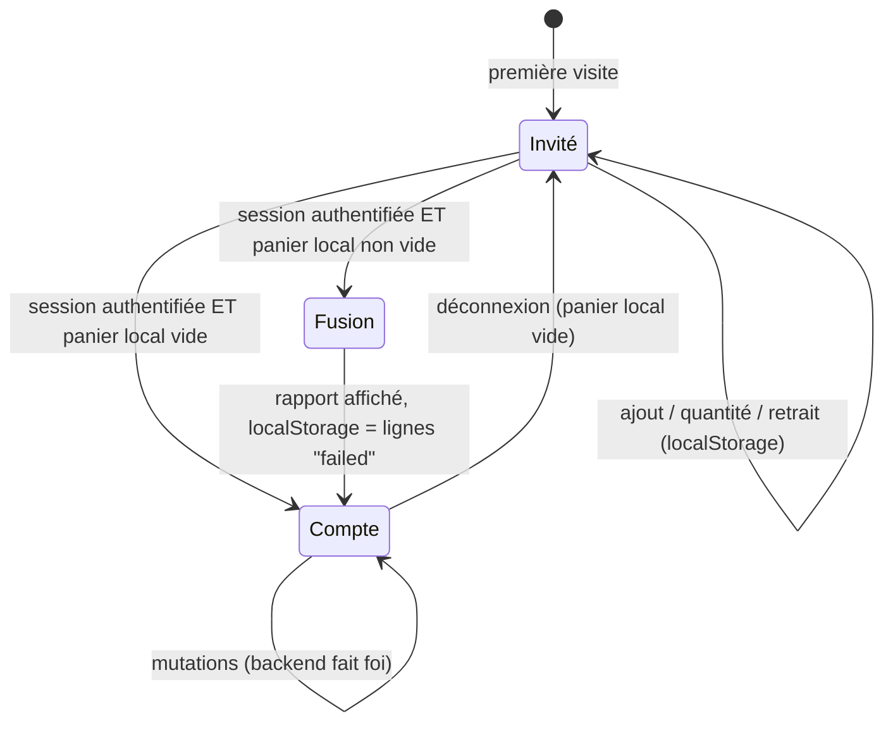

# Phase 1 — Modèle de données : lot 1

Le front n'a pas de base de données. Ce document décrit les **schémas Zod** (`lib/schemas/`) :
ceux qui valident les réponses du backend, les entrées utilisateur et les données stockées sur le
navigateur. Types backend : `docs/backend/api-map.md` §D et OpenAPI (`lib/api/schema.d.ts` généré).

> **Convention (principe XII)** : les unions de littéraux écrites ci-dessous pour la lisibilité
> (`"guest" | "account"`, `"ok" | "insufficient-stock" | "unavailable"`, statuts, marques, codes…)
> sont implémentées en **enums string** dans `lib/enums/` ; les limites (50, 99, 5, 8, 24…) sont
> des constantes nommées de `lib/constants/`. Voir research R17.

## 1. Données backend (validées à la réception)

### Product — `lib/schemas/product.ts` (← `ProductResponseDto`)

| Champ | Zod | Notes |
|---|---|---|
| `uuid` | `z.uuid()` | typé `String` côté Java |
| `name` | `z.string().min(1)` | |
| `price` | `z.number().nonnegative()` | EUR implicite |
| `brand` | `BrandSchema` | enum des 13 marques |
| `category` | `z.string()` | clé, ex. `COMPUTER` |
| `photoUrls` | `z.array(z.url())` | peut être vide → image de repli |
| `description` | `z.string()` | |
| `attributes` | `z.record(z.string(), z.unknown())` | interprété via le schéma de catégorie |

`BrandSchema = z.enum(["ASUS","HP","LENOVO","DELL","AORUS","MSI","ACER","TOSHIBA","ALIENWARE","MICROSOFT","ALTYK","GIGABYTE","SAMSUNG"])`.

### PagedModel<T> — `lib/schemas/paged.ts`

`{ content: T[], page: { size: int, number: int, totalElements: int, totalPages: int } }`.

### ProductAvailability (← `ProductAvailabilityDto`)

`{ productUuid: uuid, availableStock: int ≥ 0, inStock: boolean }`. Les UUID inconnus sont absents
de la réponse → le front les traite comme `unavailable`.

Dérivé front `AvailabilityLevel` : `inStock=false` → `"out"` ; `availableStock ≤ 5` → `"low"`
(« plus que N ») ; sinon `"in"`.

### CategorySchema (← `ProductCategorySchemaResponseDto`)

`{ uuid, categoryKey, label, jsonSchema: string, active: boolean }`. `jsonSchema` est parsé
(`JSON.parse` + validation minimale d'un JSON Schema objet) en `CategoryFacets` :

| Type de propriété JSON Schema | Filtre généré | Champ de recherche |
|---|---|---|
| `string` avec `enum` | cases à cocher | `attributes[key] = string[]` |
| `string` sans `enum` | ignoré au lot 1 | — |
| `number` / `integer` | plage min/max | `numericRanges[key] = { min?, max? }` |
| `boolean` | interrupteur | `attributes[key] = ["true"]` |

Libellé affiché : `title` de la propriété si présent, sinon la clé humanisée.

### ActiveDiscount (← `DiscountContext`)

`{ discountKey, calculationType: "NONE"|"PERCENTAGE"|"FIXED_AMOUNT"|"BUY_ONE_GET_ONE_FREE",
percentage, fixedAmount, minOrderAmount, maxDiscountAmount: number|null, startsAt, endsAt:
string|null }` (dates `LocalDateTime` sans fuseau, lues comme UTC).

### AccountCart (← `CartResponseDto`)

`{ cartUuid: uuid|null, userUuid: uuid|null, items: CartItem[]|null, totalPrice: number|null }`,
`CartItem = { cartItemUuid, productUuid, productName, quantity: int ≥ 1, unitPrice, lineItemTotalPrice }`.
**Normalisation** : `items ?? []`, `totalPrice ?? 0` avant toute utilisation.

### CurrentUser (← `UserResponseDto` via `GET /user/me`)

Seuls `uuid`, `email`, `firstName`, `lastName` sont validés et conservés au lot 1 ; les autres
champs sont retirés par Zod (comportement par défaut), ce qui évite de dépendre du format encore
non vérifié de `birthDate`.

### ApiErrorBody (← `ErrorResponseDto`)

`{ message: string, httpStatusCode: int, errorCodeType: "TECHNICAL"|"FUNCTIONAL",
errorCode: ErrorCode, fieldErrors?: { field: string, message: string }[] }`. `ErrorCode` = enum
issu de l'OpenAPI. Voir `contracts/errors.md`.

## 2. Entrées utilisateur (validées avant envoi)

### SearchFilters — `lib/schemas/search.ts`

Source : `searchParams` de l'URL ; cible : `ProductSearchRequestDto`.

| Paramètre URL | Champ backend | Règle |
|---|---|---|
| `q` | `keyword` | ≤ 100 caractères, trim |
| `category` | `category` | `COMPUTER` \| `MONITOR` |
| `brand` (répété) | `brands` | sous-ensemble de `BrandSchema` |
| `min` | `priceMin` | entier ≥ 100 ; omis si < 100 |
| `max` | `priceMax` | entier ≤ 1 000 000, ≥ `min` |
| `a.<clé>` (répété) | `attributes[clé]` | seulement si `category` choisie |
| `r.<clé>` = `min-max` | `numericRanges[clé]` | idem |
| `page` (1-based dans l'URL) | `page` (0-based) | entier ≥ 1 |
| — | `size` | fixe : 24 |

Paramètre invalide → ignoré (jamais d'erreur), l'URL canonique est réécrite.

### RegisterInput (→ `UserCreateRequestDto`)

| Champ | Règle Zod | Message (tutoiement) |
|---|---|---|
| `email` | `z.email()` | « Vérifie ton adresse email. » |
| `firstName`, `lastName` | trim, 2–50 | « Entre 2 et 50 caractères. » |
| `sex` | `"M"` \| `"F"` | « Choisis une option. » |
| `phoneNumber` | non vide | « Indique ton numéro de téléphone. » |
| `favoriteCommunicationChanel` | `EMAIL` \| `SMS` \| `PUSH_NOTIFICATION` | — |
| `street`, `city`, `zipCode`, `country` | non vides | « Ce champ est requis. » |
| `birthDate` | optionnel, date passée → `YYYY-MM-DDT00:00:00` | « La date doit être dans le passé. » |
| `password` | ≥ 8 | « 8 caractères minimum. » |

`bankCardCreationRequestDto` n'est jamais envoyé.

### CartMutation

`{ productUuid: uuid, quantity: int 1..99 }` pour ajout et quantité absolue.

## 3. Données navigateur (non sensibles, revalidées à chaque lecture)

| Clé | Stockage | Schéma | Limites |
|---|---|---|---|
| `ct_guest_cart_v1` | localStorage | `{ items: {productUuid, quantity}[], updatedAt: ISO }` | 50 lignes, quantité 1–99 |
| `ct_recent_v1` | localStorage | `{ uuids: uuid[] }` | 8 entrées, plus récent en tête, sans doublon |
| `ct_pending_action_v1` | sessionStorage | `{ type: "add"\|"set"\|"remove", productUuid, quantity? }` | 1 action |

Contenu invalide → clé supprimée, valeur par défaut vide.

### Préférences d'interface — `lib/schemas/preferences.ts` (cookie `ct_prefs_v1`)

| Champ | Zod | Défaut |
|---|---|---|
| `version` | `z.literal(PREFERENCES_VERSION)` (constante = 1) | 1 |
| `effects` | `z.enum(EffectsLevel)` : FULL, REDUCED, OFF | FULL |
| `motion` | `z.enum(MotionIntensity)` : NORMAL, SOFT | NORMAL |
| `accent` | `z.enum(AccentVariant)` : VIOLET, BLUE, CYAN | VIOLET |
| `sound` | `z.enum(SoundSetting)` : ON, OFF | OFF |

Cookie non httpOnly, `SameSite=Lax`, `Path=/`, durée `PREFERENCES_COOKIE_MAX_AGE_SECONDS`
(1 an). Contenu invalide ou version différente → valeurs par défaut.

### Configuration de thème — `lib/theme/theme.config.ts` (type `ThemeConfig`)

| Clé | Contenu |
|---|---|
| `palette` | `bg`, `surface`, `surface2`, `border`, `text`, `textMuted`, `gold`, `rose` (valeurs de l'annexe) |
| `accents` | `Record<AccentVariant, { accent, accentText, onAccent, accentGlow, gradientFrom, gradientTo, success }>` — `accent` pour les fonds et halos, `accentText` pour le texte et le focus sur les surfaces (bleu : `#6B8FFF`), `onAccent` = `#0A0E1F` pour le texte posé sur l'accent, `success` = cyan sauf pour l'accent cyan (menthe `#7BE0A8`) |
| `typography` | familles (Sora, Inter, JetBrains Mono), graisses, interlignes, letter-spacing |
| `shape` | rayons (carte, bouton, champ), bordures, flou du verre, opacité du verre |
| `media` | tailles d'images `card`, `gallery`, `thumbnail` (largeur, hauteur) |
| `shadows` | ombres teintées (repos, survol, halo du CTA) |
| `motion` | `Record<MotionIntensity, { durationFast, durationBase, durationSlow, revealOffset, stagger, easing }>` |
| `effects` | `Record<EffectsLevel, { dotGrid, aurora, tilt, magnetic, smoothScroll, viewTransitions }>`, chacun `{ enabled, …paramètres }` |
| `sound` | volume, durée, fréquences par `UiSound` |

## 4. Vues construites par le BFF

### CartView (identique invité / compte) — cf. `docs/guest-cart.md` §6

```ts
type CartView = {
  source: "guest" | "account";
  cartUuid: string | null;
  lines: Array<{
    productUuid: string; name: string; imageUrl: string | null;
    unitPrice: number; quantity: number; lineTotal: number;
    availableStock: number | null; status: "ok" | "insufficient-stock" | "unavailable";
  }>;
  total: number;            // compte : totalPrice backend ; invité : somme estimée
  totalIsEstimate: boolean; // true pour un invité
  itemCount: number;        // somme des quantités
};
```

Compte : `imageUrl` et `availableStock` sont complétés par le BFF (`GET /product/get/{uuid}`
en cache + `GET /product/availability`) car `CartItemResponseDto` n'a pas d'image.

### MergeReport

`{ cart: CartView, merged: uuid[], capped: {productUuid, requested, added}[],
dropped: {productUuid, reason: "out-of-stock"|"not-found"}[], failed: {productUuid, quantity}[] }`.

## 5. États

### Panier



### Session

`anonymous` → (connexion OIDC) → `authenticated` → (expiresAt − 30 s) `refreshing` →
`authenticated` | `expired` (RefreshTokenError → redirection connexion) ; `authenticated` →
(déconnexion) → `anonymous`.
